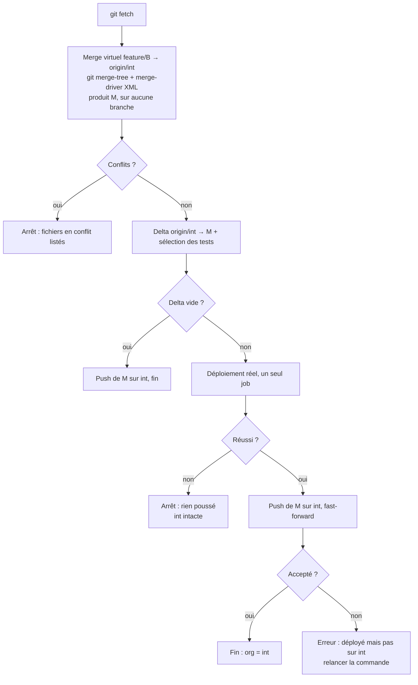

# Roadmap

État : `sf df git merge-driver` et `sf df deploy` sont implémentés (voir [deploy.md](deploy.md)), le reste est une
proposition. Chaque comportement de déploiement doit être prouvé en org (`npm run test:e2e:org`) avant d'être considéré
comme acquis.

## Positionnement

Entre les scripts CI faits main autour d'un outil de delta et les frameworks complets (sfdx-hardis) ou payants
(Gearset, Copado), `sf-df` reste **léger** :

- pas de modèle de branches imposé : cascade, promotion par ticket ou branche `release`, tout marche ;
- **une seule commande** pour livrer, `sf df deploy` : merge, delta, tests et déploiement. L'utilisateur n'enchaîne
  pas des commandes pour arriver à déployer ;
- pas de gestion des PR ni des règles de branche : c'est le rôle de la forge ;
- pas de ré-emballage des commandes `sf` qui suffisent déjà.

## `sf df deploy`

Merge une branche de travail dans une branche d'environnement et déploie le résultat sur l'org de cet environnement.
Le merge ne devient réel, et n'est ajouté à la branche, que si le déploiement a réussi.

```bash
sf df deploy --source feature/JIRA-123 --target-org int
```

### Configuration : chaque org et sa branche

L'association org ↔ branche est une donnée du projet : elle est déclarée une fois dans `sfdx-project.json`, sous la
clé `plugins` prévue par Salesforce pour la configuration des plugins, et jamais passée en flag.

```json
"plugins": {
  "sfdf": {
    "orgs": [
      { "url": "https://example--int.sandbox.my.salesforce.com", "branch": "int" },
      { "url": "https://example--uat.sandbox.my.salesforce.com", "branch": "uat" },
      { "url": "https://example.my.salesforce.com", "branch": "main" }
    ]
  }
}
```

- L'org est reconnue par son **URL My Domain**, pas par son alias : l'alias change d'un poste et d'un CI à l'autre,
  l'URL est la même pour tous et ne change pas après un refresh.
- La commande lit l'URL de `--target-org` et en déduit la branche.
- Une org absente de la config est **refusée** : impossible de déployer `int` sur l'org de recette par erreur.
- Plus tard, si utile : réglages par org (`testLevel`, suppressions autorisées), la prod plus stricte que `int`.

### Une branche = une org

La branche d'environnement **est** l'état de l'org : son dernier commit est exactement ce qui est déployé. Pas de tag,
pas d'enregistrement dans l'org, pas de fichier d'état.

Condition : **seul `sf df deploy` écrit sur la branche d'environnement.** C'est imposé par une protection de branche
dans la forge (seul le CI peut pousser), pas seulement conseillé. Conséquences :

- la PR vers `int` sert à la revue ; on ne la merge pas avec le bouton de la forge ;
- le CI lance `sf df deploy --source feature/B` ; quand le merge arrive sur `int`, la forge marque la PR comme mergée ;
- un groupe de concurrence côté CI : un seul `deploy` à la fois par org.

### Déroulé

Merge virtuel de `feature/B` dans `int`. Il produit un commit M, qui n'est encore sur aucune branche.

1. Calcul du delta entre `origin/int` et M.
2. Déploiement réel de ce delta. On n'a pas besoin de « validation puis quick deploy ».
3. S'il échoue : rien n'est poussé, `int` reste intacte. On reste dans l'état de départ.
4. S'il réussit : le merge virtuel devient réel, `int` passe sur M.



Détails :

- **Merge virtuel** : `git merge-tree --write-tree` avec le merge-driver XML (voir [merge-driver.md](merge-driver.md)),
  puis `git commit-tree` pour obtenir M. Rien n'est checkout, aucune branche ne bouge. Un conflit restant arrête tout
  et liste les fichiers : à résoudre dans la feature, puis relancer.
- **Tests** : choisis à partir des classes Apex du delta (`RunSpecifiedTests`), ou niveau imposé par `--test-level`.
- **Job unique** : package, `destructiveChangesPost.xml` et XML partiels (profils, traductions) ensemble.
- **Push** : `git push origin M:refs/heads/int`, en fast-forward seulement.

### Quand la branche et l'org se décalent

| Cas | Comportement |
| --- | --- |
| Push refusé ou échoué après un déploiement réussi | Rare avec la protection et le groupe de concurrence. Erreur claire ; on relance la commande pour la même feature : elle est redéployée (déjà présente, sans gravité) puis poussée. |
| Refresh de sandbox | La sandbox devient une copie de la prod, `int` ne la décrit plus. On lance une fois `--from main` : le delta contient ce que `int` a de plus que la prod. Si `main` est aussi poussée uniquement par `deploy`, elle décrit exactement la prod. |
| Quelqu'un contourne la protection et pousse à la main | `int` est en avance sur l'org sans que la commande le sache. D'où la protection obligatoire. |
| Modification faite à la main dans l'org | Invisible : rôle de la dérive (voir « Ensuite »). |

Après un refresh, un hotfix présent en prod mais jamais remergé dans `int` serait **supprimé** de la sandbox. La
commande liste les suppressions et demande `--allow-destructive`. Le bon réflexe : remerger `main` dans `int`.

### Flags

| Flag | Rôle |
| --- | --- |
| `--source` | Branche à livrer, mergée dans la branche de l'org (obligatoire). |
| `--target-org` | Org cible (obligatoire, ou `target-org` par défaut de `sf config`). Sa branche vient de la configuration. |
| `--dry-run` | Merge virtuel, conflits, delta et tests choisis. N'envoie rien à Salesforce, ne pousse rien. |
| `--validate` | Check-only du delta, sans push. Sert à valider une feature en PR. |
| `--from <ref>` | Remplace la branche de l'org comme point de départ du delta (refresh, premier déploiement). |
| `--allow-destructive` | Accepte un delta qui supprime des composants. |
| `--test-level` | `RunSpecifiedTests` (sélection automatique, défaut), `RunLocalTests`, `RunAllTestsInOrg`. |
| `--wait` | Durée d'attente. Au-delà, le Job ID permet de reprendre le suivi. |

### À prouver

- [x] **Git** : `git merge-tree --write-tree` applique le merge-driver passé en `-c`, avec `.gitattributes` lu sur la
      branche de l'org (`--attr-source`, git 2.40). Couvert par `test/deploy/deploy.test.ts`.
- [ ] **En org** : le job unique via SDR (`metadataApiDeployer`) : package, `destructiveChangesPost.xml` et XML partiels.
      Le test e2e `metadata-lifecycle` le prouve déjà avec `sf project deploy start`, pas encore avec SDR.
- [ ] **Forge** : une PR est bien marquée mergée quand son merge est poussé par le CI (GitHub, GitLab, Azure DevOps).

### Questions ouvertes

- **Branches protégées** : certaines équipes exigent que tout passe par le bouton de merge de la forge. Faut-il un
  mode pour elles, au risque de toucher à la gestion des PR ?
- **Message et auteur du commit de merge** : configurables, avec l'identifiant du ticket repris du nom de la branche ?

### Version 1

- **Valeurs par environnement** : marqueurs dans les sources (`{{SF_ENDPOINT}}`), remplacés au déploiement par des
  variables d'environnement. Named Credentials, e-mails, identifiants externes.
- **Sortie CI** : `--json` complet (merge, delta, tests, Job ID, erreurs), résumé lisible pour le job ou la PR,
  résultats de tests JUnit.

### Ensuite

- **Dérive** : avant de déployer, avertir si un composant du delta a été modifié dans l'org depuis le dernier
  déploiement (« ce champ a été modifié à la main le 12/10, il va être écrasé »).
- **Retour arrière** : delta inverse vers un ancien commit, suppressions comprises. Limites : données perdues, types non
  supprimables.
- **Étapes avant / après** : scripts Apex anonymes versionnés (`scripts/pre/`, `scripts/post/`) exécutés autour du
  déploiement.

## Commandes indépendantes

Outils d'appoint, utiles seuls. Aucun n'est nécessaire pour livrer : c'est le rôle de `deploy`.

### Vague 1

| Commande | Rôle |
| --- | --- |
| `sf df git merge-driver install` | **Fait** : fusion par clé des XML conteneurs au lieu de ligne à ligne. Voir [merge-driver.md](merge-driver.md). |
| `sf df test select --from <ref> --to <ref>` | Classes de test à lancer, déduites des classes Apex du delta. Même logique que la sélection de tests de `deploy`. |
| `sf df org drift --target-org int` | Composants modifiés directement dans l'org par rapport à la branche. Option : les récupérer dans une branche dédiée. |
| `sf df org changes --target-org int` | **Done**: the latest changes of an org, with date and author, written to a `package.xml` to retrieve them. See [org-changes.md](org-changes.md). Next: a column telling whether the component is in the project, a bridge towards `org drift`. |
| `sf df profile retrieve` | **Done**: complete profiles that deploy, the other types left to `sf project retrieve start`. See [profile-retrieve.md](profile-retrieve.md). |
| `sf df profile to-permset` | **Done**: moves the accesses of a profile to a permission set and revokes them on the profile. See [profile-to-permset.md](profile-to-permset.md). |
| `sf df org align --target-org uat` | **Done**: removes from profiles, permission sets and translations the references to components the target org lacks, so that they deploy. See [align.md](align.md). |

### Vague 2

| Commande | Rôle |
| --- | --- |
| `sf df env compare --from int --to uat` | Tickets et composants présents sur une branche d'environnement et absents d'une autre. |
| `sf df release notes --from <ref> --to <ref>` | Changements regroupés par ticket (identifiant dans le nom de branche ou le message de commit) avec leurs composants. |
| `sf df deps check --from <ref> --to <ref> --target-org uat` | Composants référencés par le delta (champs, objets, classes) absents de l'org cible et du delta. |

### Vague 3

| Commande | Rôle |
| --- | --- |
| `sf df flow clean --target-org int --keep 5` | Supprime les anciennes versions inactives des Flows, garde les N dernières. |
| `sf df xml normalize` | Tri et formatage stables des XML de metadata, pour réduire les diffs et les conflits après un retrieve. |

`git merge-preview` et `promote` sont retirés : `deploy --dry-run` et `deploy --source` les couvrent.

## Hors périmètre

- Gestion des PR et des règles de branche : la forge.
- Données métier : seules les metadata passent par le plugin.
